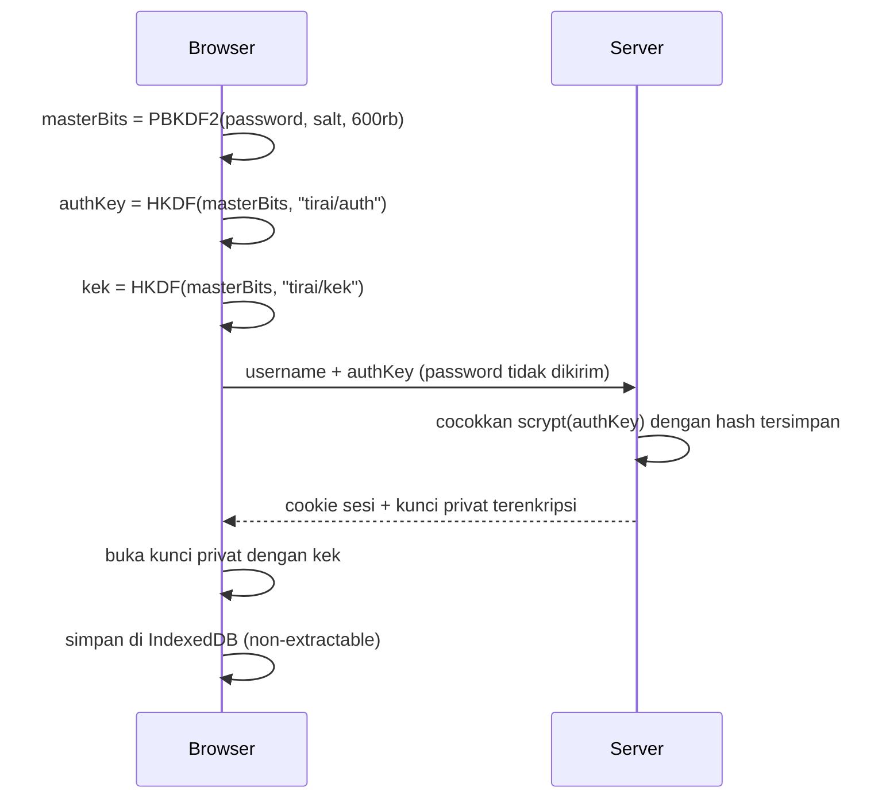
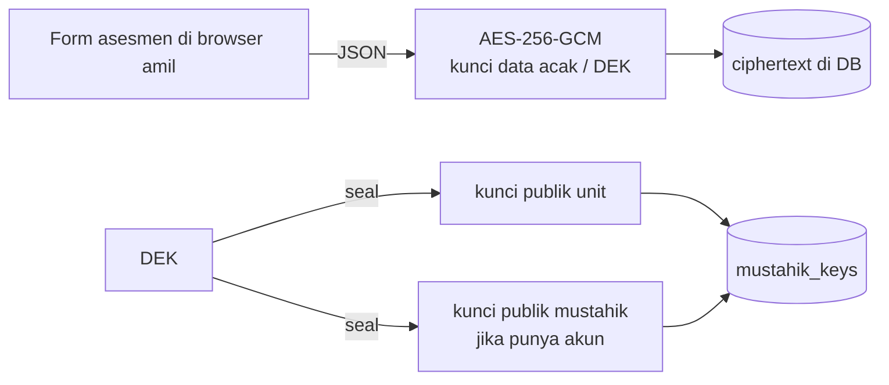
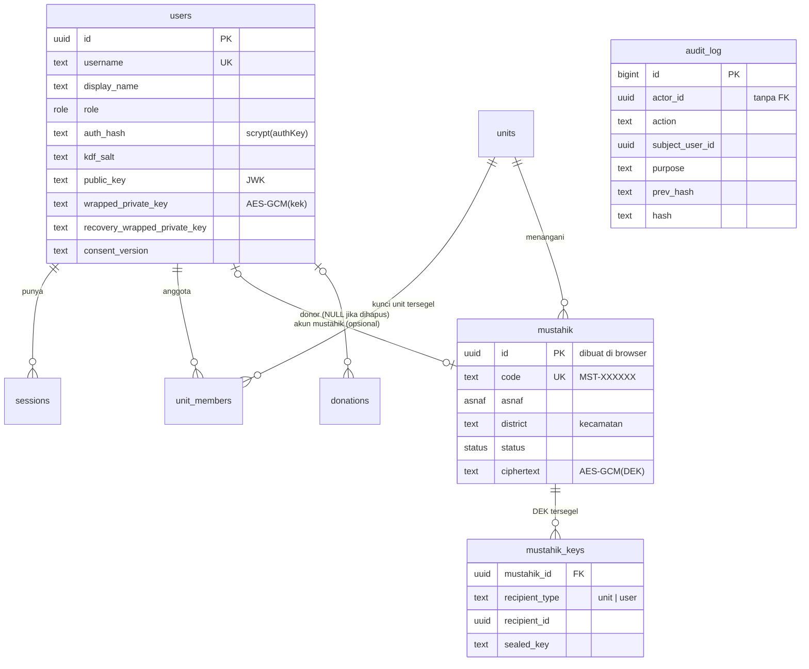

# Arsitektur Tirai

**Tirai** adalah sistem informasi ZISWAF (zakat, infak, sedekah, wakaf) yang dirancang dengan prinsip *privacy by design*. Data pribadi mustahik dienkripsi di browser sebelum dikirim, sehingga server, admin, maupun pengembang tidak bisa membacanya. Yang bisa membuka hanya amil di unit yang menangani mustahik tersebut dan mustahik itu sendiri. Setiap kali data dibuka, alasan pembukaannya dicatat dan bisa dilihat oleh mustahik serta auditor.

> Tugas Besar ICT dan Islam, Topik D: Aplikasi Privacy-First Berbasis Prinsip Digital Amanah.

Status setiap bagian di dokumen ini ditandai dengan **[sudah]** (ada di kode kerangka) atau **[rencana]** (belum dibangun, masuk peta jalan).

---

## 1. Masalah yang diselesaikan

Lembaga amil zakat menyimpan data yang sangat sensitif tentang mustahik: NIK, alamat, penghasilan, jumlah tanggungan, sampai kondisi kesehatan dan keluarga. Di banyak sistem, data ini tersimpan polos di basis data dan bisa dibaca siapa saja yang punya akses server. Akibatnya:

1. **Kebocoran basis data** langsung membuka identitas orang-orang miskin dan rentan.
2. **Orang dalam yang penasaran** (tajassus) bisa membuka data tanpa alasan, dan tidak ada jejaknya.
3. **Mustahik tidak tahu** siapa yang melihat datanya dan untuk apa, serta tidak bisa meminta datanya dihapus.
4. **Donatur yang ingin anonim** tetap tercatat dengan nama di layar petugas.

## 2. Aktor dan peran

| Peran | Siapa | Yang boleh dilakukan |
|---|---|---|
| `donatur` | Muzakki/munfiq yang mendaftar sendiri | Berdonasi (boleh anonim), melihat riwayat donasinya sendiri |
| `mustahik` | Penerima manfaat yang punya akun | Melihat data asesmennya sendiri dan siapa saja yang membukanya |
| `amil` | Petugas lembaga di satu unit | Mendaftarkan mustahik, membuka data mustahik di unitnya (wajib menyebut tujuan), melihat daftar donasi |
| `auditor` | Dewan pengawas / auditor syariah | Melihat log audit, memeriksa keutuhannya, dan melihat laporan agregat. **Tidak** bisa melihat identitas siapa pun |
| `admin` | Pengelola teknis sistem | Mengelola akun **[rencana]**. **Tidak** punya kunci untuk membaca data mustahik |

Semua peran bisa membuka halaman **Data Saya** untuk melihat, mengekspor, dan menghapus datanya sendiri.

Pemisahan ini disengaja: admin yang mengelola server tidak sama dengan amil yang memegang kunci data, dan auditor yang memeriksa tidak bisa melihat identitas. Tidak ada satu peran pun yang bisa melakukan segalanya.

### Matriks izin (RBAC) [sudah]

Diterapkan di [`src/lib/rbac.ts`](../src/lib/rbac.ts) dan diperiksa di setiap route API.

| Izin | donatur | mustahik | amil | auditor | admin |
|---|:-:|:-:|:-:|:-:|:-:|
| `donation:create` | ✓ | | | | |
| `donation:read:own` | ✓ | | | | |
| `donation:read:all` | | | ✓ | | |
| `mustahik:create` | | | ✓ | | |
| `mustahik:list` | | | ✓ | | |
| `mustahik:open` | | | ✓ | | |
| `report:read` | | | ✓ | ✓ | |
| `audit:read` | | | | ✓ | |
| `user:manage` | | | | | ✓ |
| `data:own` | ✓ | ✓ | ✓ | ✓ | ✓ |

Izin peran saja tidak cukup untuk membuka data mustahik. Amil juga harus **anggota unit** yang memegang kunci data tersebut. Jadi amil dari unit lain tetap tidak bisa membaca, walaupun perannya sama.

## 3. Klasifikasi data dan minimisasi

| Data | Kelas | Perlakuan |
|---|---|---|
| Nama, NIK, alamat lengkap, nomor HP mustahik | Data pribadi | **Dienkripsi di browser** (E2EE) |
| Penghasilan, tanggungan, kondisi kesehatan/keluarga | Data pribadi spesifik menurut UU PDP (data keuangan pribadi, kesehatan) | **Dienkripsi di browser** (E2EE) |
| Kategori asnaf, kecamatan, status verifikasi | Internal | Polos, dipakai untuk laporan agregat |
| Kode pseudonim mustahik (mis. `MST-3FA9C1`) | Pseudonim | Polos, dipakai sebagai pengganti nama di semua daftar |
| Nama tampilan donatur | Data pribadi | Polos, **disembunyikan** jika donatur memilih anonim |
| Nominal dan program donasi | Keuangan lembaga | Polos, untuk akuntabilitas |
| Username, hash kunci autentikasi | Akun | Hash (scrypt), password tidak pernah sampai ke server |
| Log audit | Akuntabilitas | Hanya bisa ditambah, berantai hash, berisi UUID (bukan nama) |

Prinsip minimisasi yang diterapkan:

- Wilayah hanya disimpan sampai **kecamatan**, bukan alamat lengkap, untuk keperluan laporan.
- **Tidak ada** tanggal lahir, foto KTP, atau lokasi GPS di kerangka ini.
- Server tidak menyimpan **password** sama sekali, bahkan dalam bentuk hash (lihat bagian 4.1).

## 4. Desain enkripsi [sudah]

Semua operasi kriptografi memakai **Web Crypto API** bawaan browser dan Node.js, tanpa pustaka pihak ketiga. Kodenya ada di [`src/lib/crypto/`](../src/lib/crypto/) dan berjalan sama persis di browser maupun di skrip seed/test.

| Kebutuhan | Algoritma |
|---|---|
| Menurunkan kunci dari password | PBKDF2-SHA256, 600.000 iterasi, lalu HKDF-SHA256 |
| Enkripsi data | AES-256-GCM (terautentikasi) |
| Kunci asimetris | ECDH P-256 |
| Menyegel kunci untuk penerima | ECDH ephemeral + HKDF + AES-256-GCM (pola ECIES) |
| Hash password di server | scrypt (N=2¹⁴, r=8, p=1) |
| Rantai log audit | SHA-256 |

### 4.1 Login tanpa server mengetahui password (zero-knowledge)

Dari satu password, browser menurunkan dua kunci yang berbeda:

- **`authKey`** dikirim ke server untuk login. Server menyimpannya dalam bentuk hash scrypt.
- **`kek`** (*key encryption key*) tidak pernah keluar dari browser. Kunci ini membuka kunci privat pengguna.

Karena HKDF searah, server yang mengetahui `authKey` tetap tidak bisa menghitung `kek`. Akibatnya server tidak bisa membuka kunci privat siapa pun.

Saat mendaftar, browser juga membuat **kunci pemulihan** acak 256-bit yang ikut mengenkripsi kunci privat. Kunci ini ditampilkan sekali dan harus disimpan pengguna. Tanpa kunci pemulihan, lupa password berarti data terenkripsi tidak bisa dibuka lagi. Ini konsekuensi yang disengaja dari E2EE. Alur pemulihan di antarmuka masih **[rencana]**.

Untuk mencegah penyerang menebak username yang terdaftar, endpoint `prelogin` tetap mengembalikan salt untuk username yang tidak ada. Salt palsu itu dihitung dari HMAC rahasia server sehingga selalu sama untuk username yang sama.

### 4.2 Kunci unit (lembaga amil)

Setiap unit amil punya pasangan kunci ECDH sendiri. Kunci privat unit disegel ke kunci publik **setiap** amil anggotanya (tabel `unit_members.sealed_unit_key`). Dengan begitu:

- Data mustahik cukup disegel ke **satu** kunci publik unit, bukan ke setiap amil.
- Amil baru bisa diberi akses tanpa mengenkripsi ulang semua data: amil lama cukup menyegel kunci unit ke kunci publik amil baru **[rencana]**.
- Amil yang keluar dihapus dari `unit_members`. Untuk keamanan penuh, kunci unit perlu dirotasi **[rencana]**.

### 4.3 Enkripsi data mustahik

1. Browser amil membuat UUID record dan **DEK** (*data encryption key*) AES-256 acak.
2. Isi asesmen dienkripsi dengan DEK. UUID record dipakai sebagai *additional authenticated data* (AAD), jadi ciphertext tidak bisa ditukar ke record lain tanpa ketahuan.
3. DEK disegel ke kunci publik unit, dan juga ke kunci publik mustahik jika mustahik punya akun.
4. Server hanya menerima ciphertext dan DEK tersegel.

### 4.4 Membuka data harus menyebut tujuan

Amil tidak bisa mengunduh ciphertext secara langsung. Satu-satunya jalan adalah `POST /api/mustahik/{id}/open` dengan **tujuan** (minimal 10 karakter, mis. "Verifikasi kelayakan untuk penyaluran Ramadan"). Server:

1. memeriksa izin `mustahik:open` dan keanggotaan unit,
2. **mencatat** pembukaan ke log audit, lengkap dengan tujuan dan ID mustahik sebagai subjek,
3. baru kemudian mengirim ciphertext dan DEK tersegel milik unit.

Mustahik bisa melihat catatan ini di halaman **Data Saya**: siapa (ID amil), kapan, dan untuk apa datanya dibuka.

### 4.5 Log audit berantai hash [sudah]

Setiap entri log menyimpan `hash = SHA-256(prevHash ‖ isi entri)`. Jika ada entri lama yang diubah atau dihapus langsung di basis data, rantainya putus dan pemeriksaan di halaman auditor akan menunjukkan entri pertama yang rusak. Penulisan log diserialkan dengan `pg_advisory_xact_lock` supaya dua permintaan bersamaan tidak menghasilkan cabang rantai.

Log memakai UUID pengguna, bukan nama. Setelah akun dihapus, UUID itu tidak lagi bisa dikaitkan dengan siapa pun, sehingga log tetap utuh tanpa menyimpan identitas.

## 5. Model ancaman

| Ancaman | Dampak tanpa Tirai | Mitigasi di Tirai |
|---|---|---|
| Basis data bocor | Identitas mustahik terbuka | Data pribadi berupa ciphertext. Kunci privat terenkripsi dengan kunci turunan password. Menebak password perlu PBKDF2 600rb iterasi **dan** scrypt per tebakan |
| Admin atau pengembang jahat | Bisa membaca semua data | Admin tidak punya kunci unit. Server tidak pernah menerima password atau `kek` |
| Amil membuka data tanpa alasan (tajassus) | Tidak ada jejak | Wajib menyebut tujuan. Tercatat di log berantai hash dan terlihat oleh mustahik serta auditor |
| Amil dari unit lain | Bisa membaca | Tidak punya kunci unit, dan server juga menolak di level izin |
| Log audit diubah | Tidak ketahuan | Rantai hash putus dan terdeteksi saat diperiksa |
| Pencurian sesi | Akun diambil alih | Cookie `httpOnly` + `SameSite=Lax`, token disimpan sebagai hash SHA-256, kedaluwarsa 8 jam, pemeriksaan header `Origin` untuk permintaan yang mengubah data |
| Penebakan username | Daftar pengguna bocor | `prelogin` mengembalikan salt palsu yang konsisten |

**Batasan yang perlu jujur disampaikan saat sidang:**

- **Server yang disusupi bisa mengirim JavaScript berbahaya** yang mencuri password saat diketik. Ini batasan semua E2EE berbasis web. Mitigasi lanjutan: kode sumber terbuka, *Content Security Policy*, *Subresource Integrity*, atau aplikasi desktop/mobile **[rencana]**.
- Perangkat amil yang terinfeksi malware bisa membaca data yang sedang dibuka.
- Log mencatat bahwa ciphertext **diberikan**. Log tidak bisa membuktikan apa yang dilakukan amil setelah membaca.
- Tanpa *blind index*, server tidak bisa mendeteksi NIK ganda (satu orang terdaftar dua kali) **[rencana]**.

## 6. Hak subjek data (UU No. 27 Tahun 2022 tentang PDP)

| Hak | Implementasi |
|---|---|
| Mengetahui dan mengakses data | Halaman **Data Saya**: daftar data yang disimpan dan log siapa yang membuka data Anda **[sudah]** |
| Portabilitas | Tombol **Ekspor**: file JSON berisi semua data Anda. Bagian terenkripsi didekripsi di browser Anda sendiri **[sudah]** |
| Penghapusan | Tombol **Hapus akun** **[sudah]**, lihat rincian di bawah |
| Persetujuan | Persetujuan eksplisit saat mendaftar, disimpan beserta versi dan waktunya **[sudah]**. Menarik persetujuan = menghapus akun |
| Perbaikan data | **[rencana]** |

Saat akun dihapus:

- Akun, kunci, dan sesi dihapus.
- DEK tersegel untuk pengguna itu dihapus (*crypto-shredding*), sehingga salinan ciphertext di cadangan pun tidak bisa dibuka dengan kuncinya.
- Riwayat donasi **tidak** dihapus, tetapi dilepas dari akun (`donor_id = NULL`) dan ditandai anonim. Nominalnya tetap ada karena lembaga wajib mempertanggungjawabkan dana (UU No. 23 Tahun 2011 tentang Pengelolaan Zakat). Ini *trade-off* antara hak hapus dan kewajiban akuntabilitas yang bisa dibahas di laporan.
- Data asesmen mustahik yang dibuat amil tetap disimpan untuk unit dan dilepas dari akun mustahik **[sudah]**. Kebijakan retensinya (kapan dihapus permanen) **[rencana]**.

## 7. Landasan syariat dan keterkaitannya dengan kode

Kolom **Di kode** menunjukkan di mana prinsip itu benar-benar diterapkan. Ini penting karena rubrik penilaian (30%) meminta prinsip syariat "dirancang eksplisit dalam kode program", bukan hanya ditulis di laporan.

| Prinsip / dalil | Maqashid | Di kode |
|---|---|---|
| **QS. An-Nisa: 58**: perintah menyampaikan amanah kepada yang berhak | Amanah data | E2EE: server tidak bisa membaca data mustahik (`src/lib/crypto/`) |
| **QS. Al-Hujurat: 12**: larangan tajassus (mencari-cari kesalahan/memata-matai) | Hifz al-Irdh | Membuka data wajib menyebut tujuan dan dicatat (`src/app/api/mustahik/[id]/open/route.ts`, `src/lib/audit.ts`) |
| **QS. Al-Baqarah: 264**: jangan merusak sedekah dengan menyebut-nyebutnya dan menyakiti penerima | Hifz al-Irdh | Mustahik ditampilkan dengan kode pseudonim, bukan nama. Auditor hanya melihat agregat |
| **QS. Al-Baqarah: 271**: menyembunyikan sedekah dan memberikannya kepada fakir lebih baik | Hifz al-Irdh | Opsi donasi anonim: amil pun hanya melihat "Hamba Allah" (`src/app/api/donasi/route.ts`) |
| **Hadis tujuh golongan yang dinaungi Allah**: bersedekah hingga tangan kiri tidak tahu apa yang diberikan tangan kanan (HR. Bukhari dan Muslim) | Hifz al-Irdh | Donasi anonim, seperti di atas |
| **Hadis menutup aib sesama muslim** (HR. Muslim) | Hifz al-Irdh, Hifz al-Nafs | Identitas dan kondisi mustahik terenkripsi, tidak pernah tampil di daftar |
| **QS. An-Nur: 27**: meminta izin sebelum memasuki rumah orang lain | Persetujuan | Persetujuan eksplisit saat mendaftar, dicatat versi dan waktunya (`users.consent_version`) |
| **QS. At-Taubah: 60**: delapan golongan penerima zakat (asnaf) | Hifz al-Mal | Enum `asnaf` di skema basis data |
| **Hadis "setiap kalian adalah pemimpin dan akan dimintai pertanggungjawaban"** (HR. Bukhari dan Muslim) | Akuntabilitas | Log audit berantai hash dan peran auditor |
| **Kaidah *dar'ul mafasid muqaddamun 'ala jalbil mashalih*** (menolak kerusakan didahulukan) | Hifz al-Nafs | Minimisasi data: hanya kecamatan, tanpa tanggal lahir/foto KTP |
| **Kaidah *adh-dhararu yuzal*** (kemudaratan harus dihilangkan) | Hifz al-Irdh | Hapus akun dengan crypto-shredding |
| **Fatwa MUI No. 8 Tahun 2011 tentang Amil Zakat** | Amanah | Akses amil dibatasi pada unitnya sendiri |

> ⚠️ **Wajib diverifikasi tim sebelum dimasukkan ke laporan.** Panduan tugas besar memberi nilai E jika ada rujukan ayat atau hadis yang dipalsukan. Daftar di atas disusun dengan bantuan AI. Cocokkan setiap ayat dengan mushaf/terjemahan Kemenag, setiap hadis dengan kitab aslinya (cantumkan nomor hadis dari sumber yang kalian cek), dan setiap fatwa dengan dokumen resmi MUI. Hapus yang tidak bisa diverifikasi.

## 8. Skema basis data [sudah]

Didefinisikan di [`src/lib/db/schema.ts`](../src/lib/db/schema.ts) dengan Drizzle ORM.

`audit_log` sengaja tidak punya *foreign key* ke `users` supaya entri tetap ada setelah akun dihapus.

## 9. Teknologi

| Lapisan | Pilihan | Alasan |
|---|---|---|
| Framework | Next.js 16 (App Router) + TypeScript | Frontend dan API dalam satu proyek |
| Basis data | PostgreSQL. Untuk pengembangan bisa memakai **PGlite** (PostgreSQL dalam WebAssembly) tanpa instalasi | Anggota tim bisa langsung menjalankan proyek tanpa Docker |
| ORM | Drizzle | Skema berupa kode TypeScript, migrasi SQL bisa dibaca |
| Validasi | Zod | Semua input API divalidasi |
| Kriptografi | Web Crypto API | Bawaan browser dan Node, tanpa dependensi tambahan |
| Test | Vitest | Menguji modul kripto, RBAC, dan rantai audit |
| Tampilan | Tailwind CSS, gaya *paper cut out*, font Fredoka + Nunito | Metafora "tirai": data tersimpan di balik lapisan kertas dan hanya disingkap oleh yang berhak. Font disajikan dari server sendiri, jadi browser tidak menghubungi Google |

## 10. Peta jalan

Disusun mengikuti milestone di panduan.

**Sebelum Milestone 2 (minggu ke-12):**
- Alur pemulihan akun dengan kunci pemulihan
- Amil memberi akses unit ke amil baru (menyegel ulang kunci unit)
- Halaman admin: kelola peran pengguna
- Verifikasi status mustahik (diajukan → terverifikasi/ditolak)
- Pencatatan penyaluran dana ke mustahik (pseudonim + nominal)

**Sebelum Milestone 3 (minggu ke-15):**
- *Blind index* NIK untuk mendeteksi pendaftaran ganda tanpa membuka NIK
- Rotasi kunci unit saat amil keluar
- *Content Security Policy* dengan nonce
- Pembatasan laju percobaan login
- Lampiran terenkripsi (foto dokumen pendukung)
- Pengujian: test integrasi API dan uji penetrasi sederhana untuk bahan laporan
